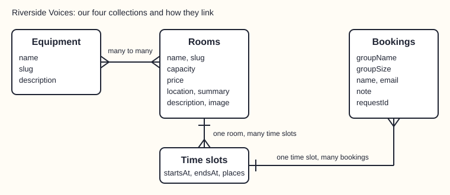

# Content and structure

Written by: Test A and Test B

What content our site holds and how it is organised. Everyone who adds a page or a field reads it first,
so the site keeps one structure.

## Content inventory

Riverside Voices is made up, so no content can be checked against a real source. "Written" below means:
written by us and entered on the site.

| Content | User question | Source | Kept up to date by (a role) | Pages | Status |
| --- | --- | --- | --- | --- | --- |
| Rooms: name, size, price per slot, place in the house, summary, description, picture | Which room holds my group, and what does it cost? | Made up by us; the records in `/admin` → Rooms (the first four came from the seed and the live-content migration) | The choir's room manager | Home, Rooms, a room's page, an equipment page | written |
| Equipment: name, description, which rooms have it | Which room has what my group needs? | Made up by us; `/admin` → Equipment, and each room's Equipment field | The room manager | Home (quick links), Rooms (filter), Equipment, a room's page | written |
| Time slots of each room | When is this room free? | The first eight weeks came from the seed or the migration; after that the room manager adds them in `/admin` → Time Slots | The room manager | A room's page (the booking form) | written until 13 December 2026 |
| Bookings: group, group size, contact name, e-mail address, note | Is my booking saved? | The booking form | The treasurer (invoices), the room manager (changes and cancellations) | Only in `/admin` (private); the public pages only count them | written by users |
| Pages: home intro, About, Contact, Privacy | Who is this choir, how do I reach it, and what does it keep about me? | Made up by us; `/admin` → Pages | The choir's secretary | `/`, `/about`, `/contact`, `/privacy` | written |
| Site facts: pricing rule, address, e-mail address | What do I pay, and where is the house? | Made up by us; `/admin` → Site facts | The secretary | Home, Rooms, a room's page, Contact, the confirmation | written |
| Pictures | What does the room look like? | Our own drawings (`src/seed/images/SOURCES.md`); `/admin` → Media | The room manager | Rooms, Home | written |
| Chat messages | Can I ask a question the pages leave open? | Typed by users; kept by tawk.to, never in our database (`docs/decisions/integration.md`) | The holder of the tawk.to account, in tawk.to's dashboard | The chat window, on every public page | written by users |

## Content model

Four collections of our own, next to the starter's Pages, Media, Users and the optional Members.

| Collection | Its fields |
| --- | --- |
| Rooms (`src/collections/Rooms.ts`) | `name`, `slug`, `capacity` (the most people it holds), `price` (EUR per two-hour slot), `location` (where in the house), `summary`, `description` (rich text), `image` (Media), `features` (many Equipment), and the reverse list `timeSlots` |
| Equipment (`features`, `src/collections/Features.ts`) | `name`, `slug`, `description`, and the reverse list `rooms` |
| Time slots (`timeSlots`, `src/collections/TimeSlots.ts`) | `room` (one Room), `startsAt`, `endsAt`, `places` (1: one group per slot), and the reverse list `bookings` (editors only) |
| Bookings (`src/collections/Bookings.ts`) | `timeSlot` (one Time slot), `groupName`, `groupSize`, `name` (the contact), `email`, `note`, `requestId` (stops double sends), `member` (members' area only) |

| Relation between | One-to-many or many-to-many |
| --- | --- |
| Rooms and Equipment | many-to-many: stored once, in each room's `features`; each piece of equipment's `rooms` reads it back |
| Rooms and Time slots | one-to-many: stored in the time slot (`room`) |
| Time slots and Bookings | one-to-many: stored in the booking (`timeSlot`) |

The database refuses to delete a room that has time slots, a time slot that has bookings, or equipment
a room still lists.

- **Our many-to-many:** Rooms and Equipment. A room's page (`/rooms/<slug>`) lists its equipment, and
  each equipment page (`/equipment/<slug>`) lists the rooms that have it.
- **Our drawing:**

## Sitemap

| Page | Address | Its job | Leads to |
| --- | --- | --- | --- |
| Home | `/` | Says what the choir rents out, and starts both tasks | Rooms, a room, the filtered rooms list (equipment quick links), About |
| Rooms | `/rooms`, filtered: `/rooms?people=25&feature=upright-piano` | Find a room: the list with its two filters | A room, an equipment page |
| A room | `/rooms/<slug>`, later weeks: `/rooms/<slug>?from=2` | Book a room: its size, price and equipment, and the booking form | Its equipment, the confirmation, back to the (filtered) rooms list |
| Equipment | `/equipment` | Lists every piece of equipment | An equipment page |
| One piece of equipment | `/equipment/<slug>` | Shows the rooms that have it | Its rooms, the rooms list filtered by it |
| About | `/about` | Says who the choir is and how the rental works | Contact |
| Contact | `/contact` | Gives the address and the e-mail address | — |

That is seven pages that count.

| Page that does not count | Address |
| --- | --- |
| The confirmation page | `/rooms/<slug>/booked?ref=…`; it leads to the calendar file, Contact, back to the room and Home |
| The privacy page | `/privacy` |
| The not-found page | Any other address shows "We could not find that page", with **Go to the home page** and **See the rooms** |

The calendar file is a download, not a page: `/rooms/<slug>/booked/calendar?ref=…`.

## Navigation labels

- **The words in our main menu:** Home, Rooms, Equipment, About, Contact. The footer adds Privacy.
- **Why users will understand these words:** "Rooms", not "Book": a group first looks at the rooms, and
  every room page has its booking form; the home page's main button says "Find and book a room".
  "Equipment", not "Features": it is the word a group uses when it asks "do you have a drum kit?". Five
  short words fit on one or two rows on a phone, with no menu button to find first.

## Each user task, step by step

**Task 1:** Book a practice room for a time slot

1. On the home page, the user chooses **Find and book a room**, or a room card.
2. The Rooms page lists the rooms. The user opens a room. (The filters are optional here: task 2.)
3. The room's page shows its size, price and equipment, and the time slots of the next two weeks, each
   "Free" or "Booked". **Later time slots** shows the two weeks after.
4. The user chooses a free time slot, fills in the group, the number of people, a contact name, an e-mail
   address and optionally a note, and chooses **Book this slot**.
5. When it is not saved, the box at the top lists each problem with a link to its field, and everything
   typed stays.
6. When it is saved, the confirmation shows the room, the time and the address, what happens next, and
   **Add to my calendar** (a `.ics` file).

**Task 2:** Find the room that fits your group

1. On the home page, the user chooses an equipment quick link, or **Find and book a room**.
2. On the Rooms page, the user chooses **Group size** and **Equipment**, then **Show rooms**. The result
   line says how many rooms fit.
3. The user opens a room. Its equipment links to each equipment page, which lists every room that has it.
4. **Back to the filtered rooms** returns to the same list, with the filters kept. The user knows which
   rooms fit the group.

On every public page, the chat button in the bottom corner opens the tawk.to chat window, for a question
the pages do not answer (R13). Both tasks work without it.

### Features of the tasks

- **The calendar file** (task 1, step 6; R11): **Add to my calendar** on the confirmation page downloads
  `riverside-voices-<room>.ics`, made by our own site (`src/lib/calendar.ts`, the route
  `/rooms/<slug>/booked/calendar?ref=…`). It holds the room, the start and end, the address and how to
  change or cancel; never the group, a name, an e-mail address or the note. It answers only for a signed
  confirmation link of that room (404 otherwise). It sends nothing to another service, so it is a feature
  of the booking task, not our integration; why we chose it is in `docs/decisions/calendar-file.md`.
